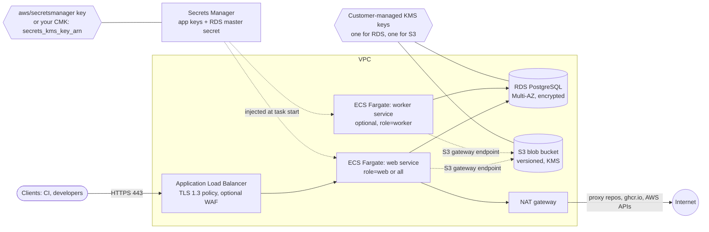

<!--
SPDX-FileCopyrightText: The OpenArtifact Authors

SPDX-License-Identifier: AGPL-3.0-or-later
-->

# terraform-aws-openartifact

[](https://registry.terraform.io/modules/openartifact/openartifact/aws)
[](https://github.com/openartifact/terraform-aws-openartifact/actions/workflows/ci.yml)
[](https://github.com/openartifact/terraform-aws-openartifact/actions/workflows/security.yml)
[](https://github.com/openartifact/terraform-aws-openartifact/actions/workflows/reuse.yml)

Production-grade Terraform / OpenTofu modules that deploy [OpenArtifact](https://github.com/openartifact/openartifact), a self-hosted artifact repository, on AWS.

The root module deploys OpenArtifact on **ECS Fargate** behind an Application Load Balancer, with a PostgreSQL database on RDS, blobs on S3, secrets in Secrets Manager and every data store encrypted at rest (customer-managed KMS keys for S3 and RDS). Building blocks (`modules/network`, `modules/storage`, `modules/secrets`, `modules/database`, `modules/ecs-service`) and a `modules/eks` module for existing EKS clusters can be used on their own.

## What it deploys



| Component | Module | Notes |
|---|---|---|
| Network (optional) | `modules/network` | VPC, public and private subnets, NAT (single or per AZ), S3 gateway endpoint, flow logs. Optional: the root module takes `vpc_id` and subnet IDs, so any existing VPC works. |
| ALB | root | HTTPS only; port 80 is a permanent redirect; TLS 1.3 policy; drops invalid headers; optional WAF association. |
| Web / worker services | `modules/ecs-service` | Fargate, `awsvpc`, read-only root filesystem, non-root (uid 10001), ARM64 by default, circuit breaker with rollback, autoscaling. |
| Database | `modules/database` | RDS PostgreSQL, Multi-AZ, encrypted, forced TLS, managed master password in Secrets Manager. |
| Blob storage | `modules/storage` | Private S3 bucket, versioning, KMS (CMK), lifecycle rules, TLS-only bucket policy. |
| Secrets | `modules/secrets` | `OPENARTIFACT_SECRET_KEY`, `AUTH_HMAC_KEY`, metrics token and bootstrap admin password, generated with ephemeral resources: values never enter Terraform state. Encrypted with the `aws/secretsmanager` key unless you set `secrets_kms_key_arn`. |

## Quick start

Registry source: `openartifact/openartifact/aws`. Pin a version; submodules are addressed as `openartifact/openartifact/aws//modules/<name>`.

```hcl
module "openartifact" {
  source  = "openartifact/openartifact/aws"
  version = "~> 0.1"

  name = "openartifact"

  vpc_id             = "vpc-0123456789abcdef0"
  private_subnet_ids = ["subnet-0aaa...", "subnet-0bbb..."]
  public_subnet_ids  = ["subnet-0ccc...", "subnet-0ddd..."]
  certificate_arn    = "arn:aws:acm:eu-west-1:111122223333:certificate/..."

  # No default on purpose: say explicitly who may reach the ALB.
  allowed_ingress_cidrs = ["203.0.113.0/24"]

  base_url = "https://artifacts.example.com"

  tags = {
    Environment = "production"
  }
}

output "url" {
  value = module.openartifact.url
}
```

Unreleased changes can be consumed from git: `source = "git::https://github.com/openartifact/terraform-aws-openartifact.git?ref=vX.Y.Z"`.

Then point a DNS record (alias to `alb_dns_name` / `alb_zone_id`) at the ALB, open `base_url`, and read the first-login section below. `name` is 3-17 characters (lowercase letters, digits, hyphens). Examples:

- [`examples/minimal`](examples/minimal): new VPC from `modules/network`, one web task, single-AZ database. To deploy into an existing VPC, drop the `network` module call there and pass your own `vpc_id`, `private_subnet_ids` and `public_subnet_ids`.
- [`examples/complete`](examples/complete): production-shaped: three AZs, web and worker services, Multi-AZ database, WAF, access logging and customer-managed keys.
- [`examples/eks`](examples/eks): `modules/eks` on an existing EKS cluster.

Requirements: Terraform or OpenTofu `>= 1.11` (write-only attributes and ephemeral resources), AWS provider `~> 6.72`, random provider `~> 3.9` (`modules/eks` also needs helm `~> 3.3` and kubernetes `~> 3.5`).

## ECS or EKS?

| | ECS Fargate (root module) | EKS (`modules/eks`) |
|---|---|---|
| Use when | You have no Kubernetes cluster and want the least to operate. | You already run EKS and want OpenArtifact as one more workload. |
| Compute | Fargate tasks, no nodes to patch. | Your node groups. |
| Packaging | Task definitions generated by Terraform. | The official Helm chart (`oci://ghcr.io/openartifact/charts`), pinned version. |
| S3 access | Task role. | EKS Pod Identity association. |
| Secrets | Secrets Manager values injected as environment variables at task start. | External Secrets Operator, Terraform write-only, or an existing Secret. |
| Admin bootstrap | `OPENARTIFACT_BOOTSTRAP_ADMIN_PASSWORD` only. The bootstrap admin **token** is file-only and cannot be delivered to a shell-less ECS container. | Password and token (via the chart's `bootstrap.existingSecret`). |
| Ingress | ALB created by this module. | AWS Load Balancer Controller ingress. |
| Database / S3 / KMS | Same `modules/database`, `modules/storage` and `modules/secrets`. | Same. |

## Security posture

- ALB: HTTPS only (HTTP is redirected), TLS 1.3 policy by default, invalid headers dropped, optional WAF, ingress limited to the CIDRs you list. `0.0.0.0/0` is accepted only when you write it explicitly.
- Tasks run as non-root (10001), read-only root filesystem, no privileged mode, `/tmp` on ephemeral task storage; private subnets, no public IPs by default.
- No static AWS credentials anywhere: S3 access uses the task role (ECS) or Pod Identity (EKS), scoped to the one bucket and key.
- Least-privilege IAM: the execution role reads only the secrets it injects; the task role holds only the generated storage policy.
- Security groups use standalone rule resources; the database accepts port 5432 only from the web and worker service security groups; no database egress rules.
- Encryption at rest: S3 and RDS use dedicated customer-managed KMS keys (rotation on) created by default. Application secrets use the AWS managed `aws/secretsmanager` key unless you pass `secrets_kms_key_arn`; CloudWatch log groups are encrypted only when you pass `log_kms_key_arn`. RDS forces TLS (`DB_SSLMODE=require`; `verify-full` needs the RDS CA bundle, which the shell-less image lacks).
- WAF: associate your regional web ACL with `waf_acl_arn`. When the ACL is created in the same configuration its ARN is unknown at plan time, so also set `waf_acl_enabled = true`.
- Generated secrets come from ephemeral resources and write-only attributes: they are not stored in Terraform state or plan files. Existing secrets can be supplied by ARN instead.
- S3: public access blocked, versioning, TLS-only policy, optional access logging, noncurrent-version expiry and multipart cleanup.
- RDS: not publicly accessible, deletion protection, final snapshot, 14-day backups, Performance Insights, copy tags to snapshots.
- Flow logs on the optional VPC; all CloudWatch log groups have bounded retention and optional KMS.
- Supply chain: GitHub Actions pinned by commit SHA, Trivy and Checkov in CI, REUSE-compliant licensing, Dependabot with cooldown. Findings are suppressed only inline with a justification.

## Operating

### Upgrading

1. Read the `CHANGELOG.md` section of every release between your version and the target.
2. Bump `version = "~> 0.x"` (or the git ref) and run `terraform init -upgrade`.
3. Review `terraform plan` before applying; the module avoids replacing the database, bucket and KMS keys.
4. To upgrade OpenArtifact itself, change `image_tag` (or pin `image_digest`, which wins over the tag). ECS performs a rolling deployment with a circuit breaker that rolls back on failure. Database migrations run when the new version starts; read the OpenArtifact release notes first.

### Rotating secrets

- Generated application secrets (`AUTH_HMAC_KEY`, metrics token, bootstrap admin password): bump `secret_version` to write new values, `terraform apply`, then redeploy so the tasks re-read them: `aws ecs update-service --cluster <cluster_name> --service <web_service_name> --force-new-deployment` (and the worker service). There is no automatic redeploy for these.
- **`OPENARTIFACT_SECRET_KEY` is excluded from `secret_version`**: its version is pinned. It seals stored credentials (proxy upstream passwords, managed signing keys, ...); a changed or lost key makes them permanently unreadable. Rotate it only deliberately, after re-keying or exporting what the application stored, with `terraform apply -replace=...` on that secret's version resource (see `modules/secrets/README.md`), or manage it yourself with `existing_secret_arns.secret_key`.
- The RDS master password is managed by RDS in Secrets Manager and rotates automatically (default every 7 days). The application reads environment variables only at start, so tasks must be redeployed after a rotation. With `redeploy_on_db_secret_rotation = true` (default) an EventBridge rule on the master secret's native `Secret Label Updated` event (label `AWSCURRENT`) starts a small Step Functions state machine that calls `ecs:UpdateService` with a forced new deployment. This path is **unverified against a live account** (event shape taken from the AWS documentation, covered by the plan-only tests); check the state machine's execution history after the first rotation, and set the variable to `false` if you redeploy by other means. Only the RDS master secret triggers it.

### Backup and restore

- **RDS**: automated backups and point-in-time recovery (14 days by default, up to 35), a final snapshot on destroy, deletion protection on. Restore by creating a new instance from a snapshot or a PITR target, then point `modules/database` at it through your usual import/state workflow.
- **S3**: versioning is on, so overwrites and deletes are recoverable until noncurrent versions expire (`s3_noncurrent_version_expiration_days`, 30 by default). Consider cross-region replication for disaster recovery (not created by this module).
- **`OPENARTIFACT_SECRET_KEY` must be preserved.** A restored database or archive is useless for stored credentials without the key that sealed them. It lives in Secrets Manager; keep that secret out of any destroy/recreate cycle and back its value up out of band if you can.
- **On ECS the in-application backup feature does not work**: its directory (`/var/lib/openartifact/backups`) is not writable on the read-only root filesystem. Rely on RDS snapshots and S3 versioning.
- Application-level backup, disaster recovery and rebuild-from-storage procedures are described in the OpenArtifact docs: [backup](https://github.com/openartifact/openartifact/blob/main/docs/operations/backup.md) and [disaster recovery](https://github.com/openartifact/openartifact/blob/main/docs/operations/disaster-recovery.md).

### First login (bootstrap admin)

On ECS the first admin password comes from `OPENARTIFACT_BOOTSTRAP_ADMIN_PASSWORD`, injected from Secrets Manager (`bootstrap_admin_password_enabled = true`, the default). It is used only on an empty instance. Read it once with `aws secretsmanager get-secret-value --secret-id <secret_arns.bootstrap_admin_password>` (the ARN is in the `secret_arns` output) and change it after login. The bootstrap admin **token** (`OPENARTIFACT_BOOTSTRAP_ADMIN_TOKEN_FILE`) is file-only; the shell-less image has no file mounts on Fargate, so it is **not supported on ECS** (use `modules/eks`).

### ECS runtime limits

- The root filesystem is read-only; `/tmp` is a task ephemeral volume. Upload spooling and proxy downloads land there, so `ephemeral_storage_gib` bounds the largest blob times the concurrent transfers per task. Mount permissions are inherited from the image's `/tmp` (not observed on a live Fargate task).
- `/var/lib/openartifact/backups` and the scanner cache (`/var/cache/openartifact/scanners`) are not writable: the in-app backup feature and the runtime install of Trivy/Grype scanners do not work on ECS.
- The database engine is PostgreSQL 16, 17 or 18 (`db_engine_version`, default `17`), major version only.

## Costs

The defaults favour availability and security over a minimal bill:

| Item | Driver | Reduce by |
|---|---|---|
| NAT gateway | Per hour per gateway plus per GB processed. `nat_gateway_mode = "per_az"` multiplies it. | Keep `single` for non-production; the S3 gateway endpoint already keeps blob traffic off the NAT. |
| Application Load Balancer | Per hour plus LCUs. | Share one ALB, or use `internal = true` where public access is not needed. |
| RDS | Multi-AZ doubles instance and storage cost; Performance Insights, backups and storage autoscaling add up. | `db_multi_az = false` and a smaller `db_instance_class` outside production. |
| Fargate | vCPU and GiB per hour, per task, minimum 2 web tasks. ARM64 (default) is about 20% cheaper than x86. | `web_desired_count`, autoscaling bounds, `cpu_architecture`. |
| KMS, Secrets Manager, CloudWatch | Per key, per secret, per GB of logs. | Shorter `log_retention_days`. |

## OpenTofu

Everything here works with OpenTofu `>= 1.11` as well; write-only attributes and ephemeral resources need at least 1.11 on both tools. CI validates and tests with the oldest supported and the latest release of both Terraform and OpenTofu. The modules are published to both registries.

## Development

See [CONTRIBUTING.md](CONTRIBUTING.md). Short version: `make fmt lint validate test docs security reuse`.

## Licence

AGPL-3.0-or-later, see [LICENSE](LICENSE). Vendored agent skills keep their upstream licences (see `.agents/skills/README.md`).

<!-- BEGIN_TF_DOCS -->
## Requirements

| Name | Version |
| ---- | ------- |
| <a name="requirement_terraform"></a> [terraform](#requirement\_terraform) | >= 1.11 |
| <a name="requirement_aws"></a> [aws](#requirement\_aws) | ~> 6.72 |

## Providers

| Name | Version |
| ---- | ------- |
| <a name="provider_aws"></a> [aws](#provider\_aws) | ~> 6.72 |

## Modules

| Name | Source | Version |
| ---- | ------ | ------- |
| <a name="module_database"></a> [database](#module\_database) | ./modules/database | n/a |
| <a name="module_secrets"></a> [secrets](#module\_secrets) | ./modules/secrets | n/a |
| <a name="module_storage"></a> [storage](#module\_storage) | ./modules/storage | n/a |
| <a name="module_web"></a> [web](#module\_web) | ./modules/ecs-service | n/a |
| <a name="module_worker"></a> [worker](#module\_worker) | ./modules/ecs-service | n/a |

## Resources

| Name | Type |
| ---- | ---- |
| [aws_ecs_cluster.this](https://registry.terraform.io/providers/hashicorp/aws/latest/docs/resources/ecs_cluster) | resource |
| [aws_lb.this](https://registry.terraform.io/providers/hashicorp/aws/latest/docs/resources/lb) | resource |
| [aws_lb_listener.http_redirect](https://registry.terraform.io/providers/hashicorp/aws/latest/docs/resources/lb_listener) | resource |
| [aws_lb_listener.https](https://registry.terraform.io/providers/hashicorp/aws/latest/docs/resources/lb_listener) | resource |
| [aws_lb_listener_certificate.additional](https://registry.terraform.io/providers/hashicorp/aws/latest/docs/resources/lb_listener_certificate) | resource |
| [aws_lb_target_group.web](https://registry.terraform.io/providers/hashicorp/aws/latest/docs/resources/lb_target_group) | resource |
| [aws_security_group.alb](https://registry.terraform.io/providers/hashicorp/aws/latest/docs/resources/security_group) | resource |
| [aws_vpc_security_group_egress_rule.to_web](https://registry.terraform.io/providers/hashicorp/aws/latest/docs/resources/vpc_security_group_egress_rule) | resource |
| [aws_vpc_security_group_ingress_rule.http_redirect_ipv4](https://registry.terraform.io/providers/hashicorp/aws/latest/docs/resources/vpc_security_group_ingress_rule) | resource |
| [aws_vpc_security_group_ingress_rule.http_redirect_ipv6](https://registry.terraform.io/providers/hashicorp/aws/latest/docs/resources/vpc_security_group_ingress_rule) | resource |
| [aws_vpc_security_group_ingress_rule.https_ipv4](https://registry.terraform.io/providers/hashicorp/aws/latest/docs/resources/vpc_security_group_ingress_rule) | resource |
| [aws_vpc_security_group_ingress_rule.https_ipv6](https://registry.terraform.io/providers/hashicorp/aws/latest/docs/resources/vpc_security_group_ingress_rule) | resource |
| [aws_wafv2_web_acl_association.this](https://registry.terraform.io/providers/hashicorp/aws/latest/docs/resources/wafv2_web_acl_association) | resource |

## Inputs

| Name | Description | Type | Default | Required |
| ---- | ----------- | ---- | ------- | :------: |
| <a name="input_additional_certificate_arns"></a> [additional\_certificate\_arns](#input\_additional\_certificate\_arns) | ARNs of additional ACM certificates attached to the HTTPS listener (SNI), for serving more than one host name. | `list(string)` | `[]` | no |
| <a name="input_alb_access_logs_bucket"></a> [alb\_access\_logs\_bucket](#input\_alb\_access\_logs\_bucket) | S3 bucket for ALB access logs (bucket name and optional key prefix), or null to disable access logs. The bucket must already exist in the same region with a bucket policy that lets the regional Elastic Load Balancing log delivery principal write to it (see examples/complete). Create the policy before the ALB: the module cannot, the bucket is not its own. | <pre>object({<br/>    bucket = string<br/>    prefix = optional(string)<br/>  })</pre> | `null` | no |
| <a name="input_alb_deletion_protection"></a> [alb\_deletion\_protection](#input\_alb\_deletion\_protection) | Block deletion of the ALB through the API. Disable it (and apply) before destroying the deployment. | `bool` | `true` | no |
| <a name="input_alb_deregistration_delay_seconds"></a> [alb\_deregistration\_delay\_seconds](#input\_alb\_deregistration\_delay\_seconds) | Seconds the ALB keeps a deregistering task in the target group (draining). Null computes shutdown\_delay\_seconds + shutdown\_timeout\_seconds so in-flight downloads finish before the task is stopped. | `number` | `null` | no |
| <a name="input_alb_idle_timeout"></a> [alb\_idle\_timeout](#input\_alb\_idle\_timeout) | ALB idle timeout in seconds (1-4000). Large uploads and downloads can sit idle between chunks, so the default is 300. The server's keep-alive timeout (SERVER\_IDLE\_TIMEOUT) is set 60 seconds above it so the ALB, not the task, closes idle connections. | `number` | `300` | no |
| <a name="input_allowed_ingress_cidrs"></a> [allowed\_ingress\_cidrs](#input\_allowed\_ingress\_cidrs) | IPv4 CIDR blocks allowed to reach the ALB on ports 443 and 80 (80 only redirects to HTTPS). There is deliberately no default: decide who may reach your artifact repository. "0.0.0.0/0" is accepted only when you list it explicitly (a check block warns about it). The list must not be empty; for an IPv6-only ALB use allowed\_ingress\_ipv6\_cidrs and list at least one IPv4 block you control. | `list(string)` | n/a | yes |
| <a name="input_allowed_ingress_ipv6_cidrs"></a> [allowed\_ingress\_ipv6\_cidrs](#input\_allowed\_ingress\_ipv6\_cidrs) | IPv6 CIDR blocks allowed to reach the ALB on ports 443 and 80. A non-empty list switches the ALB to dualstack, which requires IPv6 CIDRs on the ALB subnets (modules/network creates IPv4-only subnets). | `list(string)` | `[]` | no |
| <a name="input_assign_public_ip"></a> [assign\_public\_ip](#input\_assign\_public\_ip) | Give the tasks a public IPv4 address. Keep false and run them in private subnets; enable it only when the subnets are public and there is no NAT gateway. | `bool` | `false` | no |
| <a name="input_base_url"></a> [base\_url](#input\_base\_url) | Public URL of the repository (for example https://artifacts.example.com), injected as BASE\_URL. Required for SSO, SAML and webhooks and when serving under a path prefix. When null, BASE\_URL is not set, the server derives URLs from the request (trusting X-Forwarded-* only from trusted\_proxy\_cidrs) and the url output falls back to https://<ALB DNS name>. | `string` | `null` | no |
| <a name="input_bootstrap_admin_password_enabled"></a> [bootstrap\_admin\_password\_enabled](#input\_bootstrap\_admin\_password\_enabled) | Generate the initial admin password and inject it as OPENARTIFACT\_BOOTSTRAP\_ADMIN\_PASSWORD. It is used only on an empty instance; read it once from Secrets Manager and change it after the first login. The bootstrap admin token is file-only and not supported on ECS. | `bool` | `true` | no |
| <a name="input_certificate_arn"></a> [certificate\_arn](#input\_certificate\_arn) | ARN of the ACM certificate for the HTTPS listener. It must cover the host name clients use (see base\_url) and live in the region of the deployment. The module does not create or validate certificates. | `string` | n/a | yes |
| <a name="input_container_insights"></a> [container\_insights](#input\_container\_insights) | CloudWatch Container Insights of the ECS cluster: "enabled", "enhanced" (more detailed metrics, higher cost) or "disabled". | `string` | `"enabled"` | no |
| <a name="input_cpu_architecture"></a> [cpu\_architecture](#input\_cpu\_architecture) | CPU architecture of the Fargate tasks: ARM64 (about 20% cheaper, the default) or X86\_64. The OpenArtifact image is published for both. | `string` | `"ARM64"` | no |
| <a name="input_db_allocated_storage"></a> [db\_allocated\_storage](#input\_db\_allocated\_storage) | Initial RDS storage in GiB (20-65536). | `number` | `50` | no |
| <a name="input_db_apply_immediately"></a> [db\_apply\_immediately](#input\_db\_apply\_immediately) | Apply RDS modifications immediately instead of in the next maintenance window. Some changes (instance class, Multi-AZ, storage) cause a brief outage when applied immediately. | `bool` | `false` | no |
| <a name="input_db_backup_retention_period"></a> [db\_backup\_retention\_period](#input\_db\_backup\_retention\_period) | Days to keep automated RDS backups (1-35). | `number` | `14` | no |
| <a name="input_db_deletion_protection"></a> [db\_deletion\_protection](#input\_db\_deletion\_protection) | Block deletion of the DB instance through the API. Disable it (and apply) before destroying the deployment. | `bool` | `true` | no |
| <a name="input_db_engine_version"></a> [db\_engine\_version](#input\_db\_engine\_version) | PostgreSQL major version (16, 17 or 18). Only the major is passed to RDS; minor upgrades are applied automatically in the maintenance window. | `string` | `"17"` | no |
| <a name="input_db_instance_class"></a> [db\_instance\_class](#input\_db\_instance\_class) | RDS instance class, for example db.t4g.medium. Performance Insights is not available on db.t4g.micro and db.t4g.small. | `string` | `"db.t4g.medium"` | no |
| <a name="input_db_max_allocated_storage"></a> [db\_max\_allocated\_storage](#input\_db\_max\_allocated\_storage) | Upper limit in GiB for RDS storage autoscaling. 0 disables autoscaling; otherwise it must be at least db\_allocated\_storage. | `number` | `200` | no |
| <a name="input_db_max_open_conns"></a> [db\_max\_open\_conns](#input\_db\_max\_open\_conns) | Size of the database connection pool of each task (DB\_MAX\_OPEN\_CONNS). 0 means unlimited, otherwise at least 2. Total connections are this value times the number of tasks (web plus worker), so keep it within the RDS max\_connections of db\_instance\_class. | `number` | `25` | no |
| <a name="input_db_monitoring_interval"></a> [db\_monitoring\_interval](#input\_db\_monitoring\_interval) | Seconds between RDS Enhanced Monitoring samples (0, 1, 5, 10, 15, 30 or 60). 0 disables it; any other value creates the monitoring IAM role. | `number` | `0` | no |
| <a name="input_db_multi_az"></a> [db\_multi\_az](#input\_db\_multi\_az) | Run a synchronous standby in a second Availability Zone. Doubles the instance and storage cost; keep it on for production. | `bool` | `true` | no |
| <a name="input_db_performance_insights_enabled"></a> [db\_performance\_insights\_enabled](#input\_db\_performance\_insights\_enabled) | Enable RDS Performance Insights (encrypted with the database KMS key). Turn it off on db.t4g.micro and db.t4g.small, which do not support it. | `bool` | `true` | no |
| <a name="input_db_skip_final_snapshot"></a> [db\_skip\_final\_snapshot](#input\_db\_skip\_final\_snapshot) | Skip the final DB snapshot on destroy. Keep false in production so the data survives an accidental destroy. | `bool` | `false` | no |
| <a name="input_db_sslmode"></a> [db\_sslmode](#input\_db\_sslmode) | PostgreSQL sslmode of the connection (DB\_SSLMODE): "require" encrypts the connection (the database forces TLS) without verifying the server certificate; "verify-full" also verifies it, but needs the RDS CA bundle, which the shell-less image does not contain, so it only works with a custom image. | `string` | `"require"` | no |
| <a name="input_enable_execute_command"></a> [enable\_execute\_command](#input\_enable\_execute\_command) | Enable ECS Exec on the services. The image is shell-less, so a session has nothing to run; enable it only together with a debug image. | `bool` | `false` | no |
| <a name="input_enable_metrics_token"></a> [enable\_metrics\_token](#input\_enable\_metrics\_token) | Generate a bearer token (METRICS\_AUTH\_TOKEN) that protects the /metrics endpoint. | `bool` | `true` | no |
| <a name="input_ephemeral_storage_gib"></a> [ephemeral\_storage\_gib](#input\_ephemeral\_storage\_gib) | Task ephemeral storage in GiB (21-200) for the writable /tmp, where uploads and proxied downloads are spooled before they go to S3. Size it for the largest artifact you expect. | `number` | `50` | no |
| <a name="input_existing_secret_arns"></a> [existing\_secret\_arns](#input\_existing\_secret\_arns) | Bring-your-own Secrets Manager secrets (plain string values, not JSON): every attribute that is set is used as-is and NO secret is generated for it. Attributes: secret\_key (OPENARTIFACT\_SECRET\_KEY), hmac\_key (AUTH\_HMAC\_KEY), metrics\_token, bootstrap\_admin\_password. | <pre>object({<br/>    secret_key               = optional(string)<br/>    hmac_key                 = optional(string)<br/>    metrics_token            = optional(string)<br/>    bootstrap_admin_password = optional(string)<br/>  })</pre> | `{}` | no |
| <a name="input_extra_environment"></a> [extra\_environment](#input\_extra\_environment) | Additional plain-text environment variables for the web and worker containers (name to value), for example LOG\_LEVEL or SERVER\_IDLE\_TIMEOUT. Never put secrets here: the values are visible in the task definition. Keys that the module manages are rejected: DB\_*, STORAGE\_*, AWS\_*, BASE\_URL, OPENARTIFACT\_TRUSTED\_PROXIES, OPENARTIFACT\_ROLE, OPENARTIFACT\_SECRET\_KEY, OPENARTIFACT\_BOOTSTRAP\_ADMIN\_PASSWORD, AUTH\_HMAC\_KEY, METRICS\_AUTH\_TOKEN, SERVER\_PORT, SERVER\_SHUTDOWN\_DELAY and SERVER\_SHUTDOWN\_TIMEOUT. | `map(string)` | `{}` | no |
| <a name="input_health_check_grace_period_seconds"></a> [health\_check\_grace\_period\_seconds](#input\_health\_check\_grace\_period\_seconds) | Seconds ECS ignores failing load balancer health checks after a web task starts, to cover database connection and migrations on startup. | `number` | `60` | no |
| <a name="input_image_digest"></a> [image\_digest](#input\_image\_digest) | Image digest (sha256:<64 hex characters>) to deploy. When set it wins over image\_tag and the image becomes <image\_repository>@<digest>, which pins the exact image. | `string` | `null` | no |
| <a name="input_image_repository"></a> [image\_repository](#input\_image\_repository) | Container image repository (without tag or digest). The default image is public and multi-arch (amd64 and arm64). | `string` | `"ghcr.io/openartifact/openartifact"` | no |
| <a name="input_image_tag"></a> [image\_tag](#input\_image\_tag) | Image tag to deploy. Ignored when image\_digest is set. Prefer pinning image\_digest in production: tags are mutable. | `string` | `"0.19.2"` | no |
| <a name="input_internal"></a> [internal](#input\_internal) | Create an internal ALB in private\_subnet\_ids instead of an internet-facing one in public\_subnet\_ids. Use it when clients reach OpenArtifact over VPN, Direct Connect, peering or a transit gateway. | `bool` | `false` | no |
| <a name="input_log_kms_key_arn"></a> [log\_kms\_key\_arn](#input\_log\_kms\_key\_arn) | ARN of a customer-managed KMS key that encrypts the CloudWatch log groups, or null for the default CloudWatch Logs encryption. Its key policy must allow the logs.<region>.amazonaws.com service principal. | `string` | `null` | no |
| <a name="input_log_retention_days"></a> [log\_retention\_days](#input\_log\_retention\_days) | Retention in days of the CloudWatch log groups of the services. Must be a value CloudWatch Logs accepts; never-expire (0) is deliberately not allowed. | `number` | `90` | no |
| <a name="input_name"></a> [name](#input\_name) | Name of the deployment and prefix of every resource (ECS cluster and web service, ALB, database, bucket, secrets). The worker service is named "<name>-worker". Must be 3-17 characters: lowercase letters, digits and hyphens, starting with a letter. The limit keeps "<name>-worker" within the 24 characters the building modules accept. | `string` | `"openartifact"` | no |
| <a name="input_private_subnet_ids"></a> [private\_subnet\_ids](#input\_private\_subnet\_ids) | IDs of the private subnets (at least two, in different Availability Zones) that hold the ECS tasks and the RDS database. They need outbound internet access (NAT gateway) for proxy repositories, ghcr.io and the AWS APIs, unless you provide VPC endpoints for everything the tasks use. When internal is true the ALB is placed here as well. | `list(string)` | n/a | yes |
| <a name="input_public_subnet_ids"></a> [public\_subnet\_ids](#input\_public\_subnet\_ids) | IDs of the public subnets (at least two, in different Availability Zones) for an internet-facing ALB. Ignored when internal is true. | `list(string)` | `[]` | no |
| <a name="input_redeploy_on_db_secret_rotation"></a> [redeploy\_on\_db\_secret\_rotation](#input\_redeploy\_on\_db\_secret\_rotation) | Redeploy the ECS services when RDS rotates the managed master password (about every 7 days). The containers read DB\_PASSWORD only at start, so without a redeployment they fail to connect after a rotation. Creates an EventBridge rule and a small Step Functions state machine per service (see modules/ecs-service). Set to false only if you redeploy by other means. | `bool` | `true` | no |
| <a name="input_s3_access_logging"></a> [s3\_access\_logging](#input\_s3\_access\_logging) | S3 server access logging of the blob bucket: the target bucket (which must grant logging.s3.amazonaws.com PutObject) and key prefix. Null disables it. | <pre>object({<br/>    target_bucket = string<br/>    target_prefix = optional(string, "s3/")<br/>  })</pre> | `null` | no |
| <a name="input_s3_bucket_name"></a> [s3\_bucket\_name](#input\_s3\_bucket\_name) | Explicit name of the S3 blob bucket. Null names it "<name>-blobs-<account\_id>-<region>". | `string` | `null` | no |
| <a name="input_s3_force_destroy"></a> [s3\_force\_destroy](#input\_s3\_force\_destroy) | Delete the bucket with all objects and versions on destroy. Leave false in production: the bucket holds every stored artifact. | `bool` | `false` | no |
| <a name="input_s3_kms_mode"></a> [s3\_kms\_mode](#input\_s3\_kms\_mode) | Bucket encryption key: "cmk" creates a dedicated customer-managed KMS key with rotation (recommended); "aws\_managed" uses the AWS managed aws/s3 key. | `string` | `"cmk"` | no |
| <a name="input_s3_noncurrent_version_expiration_days"></a> [s3\_noncurrent\_version\_expiration\_days](#input\_s3\_noncurrent\_version\_expiration\_days) | Days after which noncurrent object versions are permanently deleted. Only used when s3\_versioning\_enabled is true. | `number` | `30` | no |
| <a name="input_s3_versioning_enabled"></a> [s3\_versioning\_enabled](#input\_s3\_versioning\_enabled) | Keep previous object versions, which protects blobs against accidental or malicious deletes. | `bool` | `true` | no |
| <a name="input_secret_version"></a> [secret\_version](#input\_secret\_version) | Rotation counter for the generated metrics token, HMAC key and bootstrap admin password: bump it to write new values, then redeploy the services. It never changes OPENARTIFACT\_SECRET\_KEY, whose replacement would make stored credentials permanently unreadable. | `number` | `1` | no |
| <a name="input_secrets_kms_key_arn"></a> [secrets\_kms\_key\_arn](#input\_secrets\_kms\_key\_arn) | ARN of a customer-managed KMS key that encrypts the generated application secrets, or null for the AWS managed aws/secretsmanager key. The key must be known at plan time; the task execution roles are granted kms:Decrypt on it. | `string` | `null` | no |
| <a name="input_secrets_recovery_window_in_days"></a> [secrets\_recovery\_window\_in\_days](#input\_secrets\_recovery\_window\_in\_days) | Days Secrets Manager keeps a deleted application secret recoverable (7-30), or 0 to delete immediately. Keep the default: an accidentally deleted OPENARTIFACT\_SECRET\_KEY can only be restored inside this window. | `number` | `30` | no |
| <a name="input_shutdown_delay_seconds"></a> [shutdown\_delay\_seconds](#input\_shutdown\_delay\_seconds) | Seconds the server keeps serving after SIGTERM before it stops accepting connections (SERVER\_SHUTDOWN\_DELAY), so the ALB deregisters the task first. | `number` | `15` | no |
| <a name="input_shutdown_timeout_seconds"></a> [shutdown\_timeout\_seconds](#input\_shutdown\_timeout\_seconds) | Seconds in-flight requests get to finish during shutdown (SERVER\_SHUTDOWN\_TIMEOUT). shutdown\_delay\_seconds + shutdown\_timeout\_seconds + 5 must not exceed 120, the Fargate stop timeout limit. | `number` | `60` | no |
| <a name="input_ssl_policy"></a> [ssl\_policy](#input\_ssl\_policy) | Security policy of the HTTPS listener. Must be a TLS 1.3 policy (name starting with ELBSecurityPolicy-TLS13). The default ELBSecurityPolicy-TLS13-1-2-2021-06 accepts TLS 1.2 and 1.3 with forward-secret ciphers; use ELBSecurityPolicy-TLS13-1-3-2021-06 to require TLS 1.3 (older package manager clients may fail). | `string` | `"ELBSecurityPolicy-TLS13-1-2-2021-06"` | no |
| <a name="input_tags"></a> [tags](#input\_tags) | Tags applied to every resource of the module that supports tags (merged with the provider default\_tags). | `map(string)` | `{}` | no |
| <a name="input_trusted_proxy_cidrs"></a> [trusted\_proxy\_cidrs](#input\_trusted\_proxy\_cidrs) | CIDR blocks of the reverse proxies whose X-Forwarded-* and client-IP headers the server believes (OPENARTIFACT\_TRUSTED\_PROXIES). Null trusts the VPC CIDR, which covers the ALB. An empty list trusts nobody, so client IPs and generated URLs name the ALB. Never trust 0.0.0.0/0: any client could then spoof its address. | `list(string)` | `null` | no |
| <a name="input_vpc_id"></a> [vpc\_id](#input\_vpc\_id) | ID of the existing VPC to deploy into (for example the vpc\_id output of modules/network). Its primary IPv4 CIDR is the default for trusted\_proxy\_cidrs. | `string` | n/a | yes |
| <a name="input_waf_acl_arn"></a> [waf\_acl\_arn](#input\_waf\_acl\_arn) | ARN of a regional WAFv2 web ACL to associate with the ALB, or null for none. When the web ACL is created in the same configuration its ARN is unknown at plan time, so also set waf\_acl\_enabled = true. | `string` | `null` | no |
| <a name="input_waf_acl_enabled"></a> [waf\_acl\_enabled](#input\_waf\_acl\_enabled) | Whether to associate waf\_acl\_arn with the ALB. Null (default) associates it whenever waf\_acl\_arn is set, which needs the ARN to be known at plan time. Set true when the web ACL is created in the same configuration (its ARN is only known after apply, and Terraform cannot count on that), or false to detach an ACL without losing the value. | `bool` | `null` | no |
| <a name="input_web_autoscaling"></a> [web\_autoscaling](#input\_web\_autoscaling) | Target-tracking autoscaling of the web service. When enabled, CPU tracking (cpu\_target\_percent) is always created, memory tracking when memory\_target\_percent is set, and ALB request count per target when requests\_per\_target is set (the module builds the ALB resource label). Autoscaling owns the task count after creation. | <pre>object({<br/>    enabled               = optional(bool, true)<br/>    min_capacity          = optional(number, 2)<br/>    max_capacity          = optional(number, 6)<br/>    cpu_target_percent    = optional(number, 60)<br/>    memory_target_percent = optional(number)<br/>    requests_per_target   = optional(number)<br/>    scale_in_cooldown     = optional(number, 300)<br/>    scale_out_cooldown    = optional(number, 60)<br/>  })</pre> | `{}` | no |
| <a name="input_web_cpu"></a> [web\_cpu](#input\_web\_cpu) | CPU units of each web task: 256, 512, 1024, 2048, 4096, 8192 or 16384. Must form a valid Fargate combination with web\_memory. | `number` | `1024` | no |
| <a name="input_web_desired_count"></a> [web\_desired\_count](#input\_web\_desired\_count) | Initial number of web tasks. Application Auto Scaling (web\_autoscaling) or manual scaling owns the count after creation; later changes to this value are ignored. | `number` | `2` | no |
| <a name="input_web_memory"></a> [web\_memory](#input\_web\_memory) | Memory in MiB of each web task. Valid Fargate combinations: 256 CPU 512/1024/2048; 512 CPU 1024-4096 step 1024; 1024 CPU 2048-8192 step 1024; 2048 CPU 4096-16384 step 1024; 4096 CPU 8192-30720 step 1024; 8192 CPU 16384-61440 step 4096; 16384 CPU 32768-122880 step 8192. | `number` | `2048` | no |
| <a name="input_worker_autoscaling"></a> [worker\_autoscaling](#input\_worker\_autoscaling) | Target-tracking autoscaling of the worker service on CPU (always) and memory (when memory\_target\_percent is set). Disabled by default: the worker has no load balancer and its load is background jobs, so scale it deliberately. | <pre>object({<br/>    enabled               = optional(bool, false)<br/>    min_capacity          = optional(number, 1)<br/>    max_capacity          = optional(number, 4)<br/>    cpu_target_percent    = optional(number, 60)<br/>    memory_target_percent = optional(number)<br/>    scale_in_cooldown     = optional(number, 300)<br/>    scale_out_cooldown    = optional(number, 60)<br/>  })</pre> | `{}` | no |
| <a name="input_worker_cpu"></a> [worker\_cpu](#input\_worker\_cpu) | CPU units of each worker task (same values as web\_cpu). Only used when worker\_enabled is true. | `number` | `1024` | no |
| <a name="input_worker_desired_count"></a> [worker\_desired\_count](#input\_worker\_desired\_count) | Initial number of worker tasks. Must be at least 1 when worker\_enabled is true. Changes after creation are ignored (autoscaling or manual scaling owns the count). | `number` | `1` | no |
| <a name="input_worker_enabled"></a> [worker\_enabled](#input\_worker\_enabled) | Run the background jobs (OPENARTIFACT\_ROLE=worker) in a separate service without load balancer, and the web service as role "web". When false a single service runs everything (role "all"). | `bool` | `false` | no |
| <a name="input_worker_memory"></a> [worker\_memory](#input\_worker\_memory) | Memory in MiB of each worker task; must form a valid Fargate combination with worker\_cpu (see web\_memory). Only used when worker\_enabled is true. | `number` | `2048` | no |

## Outputs

| Name | Description |
| ---- | ----------- |
| <a name="output_alb_arn"></a> [alb\_arn](#output\_alb\_arn) | ARN of the ALB. |
| <a name="output_alb_arn_suffix"></a> [alb\_arn\_suffix](#output\_alb\_arn\_suffix) | ARN suffix of the ALB (app/<name>/<id>), the dimension value of its CloudWatch metrics. |
| <a name="output_alb_dns_name"></a> [alb\_dns\_name](#output\_alb\_dns\_name) | DNS name of the ALB. Point your DNS record (CNAME, or an alias to alb\_dns\_name and alb\_zone\_id) at it. |
| <a name="output_alb_zone_id"></a> [alb\_zone\_id](#output\_alb\_zone\_id) | Route 53 hosted zone ID of the ALB, for alias records. |
| <a name="output_bucket_arn"></a> [bucket\_arn](#output\_bucket\_arn) | ARN of the S3 blob bucket. |
| <a name="output_bucket_name"></a> [bucket\_name](#output\_bucket\_name) | Name of the S3 blob bucket. |
| <a name="output_cluster_arn"></a> [cluster\_arn](#output\_cluster\_arn) | ARN of the ECS cluster. |
| <a name="output_cluster_name"></a> [cluster\_name](#output\_cluster\_name) | Name of the ECS cluster. |
| <a name="output_database_endpoint"></a> [database\_endpoint](#output\_database\_endpoint) | DNS address of the RDS instance (host name only). |
| <a name="output_database_master_secret_arn"></a> [database\_master\_secret\_arn](#output\_database\_master\_secret\_arn) | ARN of the RDS-managed Secrets Manager secret with the master credentials as JSON {username, password}. RDS rotates the password about every 7 days. |
| <a name="output_database_port"></a> [database\_port](#output\_database\_port) | Port of the RDS instance. |
| <a name="output_execution_role_arns"></a> [execution\_role\_arns](#output\_execution\_role\_arns) | ARNs of the ECS task execution roles by service (web, worker); worker is null when worker\_enabled is false. |
| <a name="output_kms_key_arns"></a> [kms\_key\_arns](#output\_kms\_key\_arns) | ARNs of the customer-managed KMS keys by purpose: storage (null with s3\_kms\_mode = "aws\_managed"), database, secrets (the key you supplied, null for the AWS managed key) and logs (the key you supplied, null for the default encryption). |
| <a name="output_log_group_names"></a> [log\_group\_names](#output\_log\_group\_names) | Names of the CloudWatch log groups by service (web, worker); worker is null when worker\_enabled is false. |
| <a name="output_secret_arns"></a> [secret\_arns](#output\_secret\_arns) | ARNs of the application secrets by logical name (null when disabled): secret\_key, hmac\_key, metrics\_token, bootstrap\_admin\_password, plus database\_master (the RDS-managed master secret). Read the bootstrap admin password with `aws secretsmanager get-secret-value`. |
| <a name="output_security_group_ids"></a> [security\_group\_ids](#output\_security\_group\_ids) | IDs of the security groups by component: alb, web, worker (null when worker\_enabled is false) and database. |
| <a name="output_task_role_arns"></a> [task\_role\_arns](#output\_task\_role\_arns) | ARNs of the ECS task roles by service (web, worker); worker is null when worker\_enabled is false. Each holds only the S3 and KMS access to the blob bucket. |
| <a name="output_url"></a> [url](#output\_url) | Public URL of the repository: base\_url when set, otherwise https://<ALB DNS name> (the certificate must cover that name for clients to connect without errors). |
| <a name="output_web_service_name"></a> [web\_service\_name](#output\_web\_service\_name) | Name of the web ECS service (role "web" with a worker, otherwise "all"). |
| <a name="output_worker_service_name"></a> [worker\_service\_name](#output\_worker\_service\_name) | Name of the worker ECS service, or null when worker\_enabled is false. |
<!-- END_TF_DOCS -->
