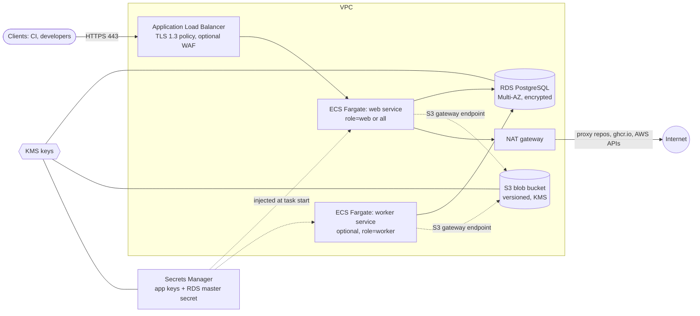

<!--
SPDX-FileCopyrightText: The OpenArtifact Authors

SPDX-License-Identifier: AGPL-3.0-or-later
-->

# terraform-aws-openartifact

[](https://registry.terraform.io/modules/openartifact/openartifact/aws)
[](https://github.com/openartifact/terraform-aws-openartifact/actions/workflows/ci.yml)
[](https://github.com/openartifact/terraform-aws-openartifact/actions/workflows/security.yml)
[](https://github.com/openartifact/terraform-aws-openartifact/actions/workflows/reuse.yml)

Production-grade Terraform / OpenTofu modules that deploy [OpenArtifact](https://github.com/openartifact/openartifact), a self-hosted artifact repository, on AWS.

The root module deploys OpenArtifact on **ECS Fargate** behind an Application Load Balancer, with a PostgreSQL database on RDS, blobs on S3, secrets in Secrets Manager and every data store encrypted with KMS. Building blocks (`modules/network`, `modules/storage`, `modules/secrets`, `modules/database`, `modules/ecs-service`) and an `modules/eks` module for existing EKS clusters can be used on their own.

## What it deploys



| Component | Module | Notes |
|---|---|---|
| Network (optional) | `modules/network` | VPC, public and private subnets, NAT (single or per AZ), S3 gateway endpoint, flow logs. Skip it to use an existing VPC. |
| ALB | root | HTTPS only; port 80 is a permanent redirect; TLS 1.3 policy; drops invalid headers; optional WAF association. |
| Web / worker services | `modules/ecs-service` | Fargate, `awsvpc`, read-only root filesystem, non-root (uid 10001), ARM64 by default, circuit breaker with rollback, autoscaling. |
| Database | `modules/database` | RDS PostgreSQL, Multi-AZ, encrypted, forced TLS, managed master password in Secrets Manager. |
| Blob storage | `modules/storage` | Private S3 bucket, versioning, KMS (CMK), lifecycle rules, TLS-only bucket policy. |
| Secrets | `modules/secrets` | `OPENARTIFACT_SECRET_KEY`, `AUTH_HMAC_KEY`, metrics token and bootstrap admin password, generated with ephemeral resources: values never enter Terraform state. |

## Quick start

Registry source: `openartifact/openartifact/aws`. Pin a version; submodules are addressed as `openartifact/openartifact/aws//modules/<name>`.

```hcl
module "openartifact" {
  source  = "openartifact/openartifact/aws"
  version = "~> 0.1"

  name = "openartifact"

  vpc_id             = "vpc-0123456789abcdef0"
  private_subnet_ids = ["subnet-0aaa...", "subnet-0bbb..."]
  public_subnet_ids  = ["subnet-0ccc...", "subnet-0ddd..."]
  certificate_arn    = "arn:aws:acm:eu-west-1:111122223333:certificate/..."

  # No default on purpose: say explicitly who may reach the ALB.
  allowed_ingress_cidrs = ["203.0.113.0/24"]

  base_url = "https://artifacts.example.com"

  tags = {
    Environment = "production"
  }
}

output "url" {
  value = module.openartifact.url
}
```

Unreleased changes can be consumed from git: `source = "git::https://github.com/openartifact/terraform-aws-openartifact.git?ref=vX.Y.Z"`.

Then point a DNS record (alias to `alb_dns_name` / `alb_zone_id`) at the ALB, open `base_url`, and read the first-login section below. See `examples/` for complete configurations (VPC included, existing VPC, EKS).

Requirements: Terraform or OpenTofu `>= 1.11` (write-only attributes and ephemeral resources), AWS provider `~> 6.72`, random provider `~> 3.9` (`modules/eks` also needs helm `~> 3.3` and kubernetes `~> 3.5`).

## ECS or EKS?

| | ECS Fargate (root module) | EKS (`modules/eks`) |
|---|---|---|
| Use when | You have no Kubernetes cluster and want the least to operate. | You already run EKS and want OpenArtifact as one more workload. |
| Compute | Fargate tasks, no nodes to patch. | Your node groups. |
| Packaging | Task definitions generated by Terraform. | The official Helm chart (`oci://ghcr.io/openartifact/charts`), pinned version. |
| S3 access | Task role. | EKS Pod Identity association. |
| Secrets | Secrets Manager values injected as environment variables at task start. | External Secrets Operator, Terraform write-only, or an existing Secret. |
| Admin bootstrap | `OPENARTIFACT_BOOTSTRAP_ADMIN_PASSWORD` only. The bootstrap admin **token** is file-only and cannot be delivered to a shell-less ECS container. | Password and token (via the chart's `bootstrap.existingSecret`). |
| Ingress | ALB created by this module. | AWS Load Balancer Controller ingress. |
| Database / S3 / KMS | Same `modules/database`, `modules/storage` and `modules/secrets`. | Same. |

## Security posture

- ALB: HTTPS only (HTTP is redirected), TLS 1.3 policy by default, invalid headers dropped, optional WAF, ingress limited to the CIDRs you list. `0.0.0.0/0` is accepted only when you write it explicitly.
- Tasks run as non-root (10001), read-only root filesystem, no privileged mode, `/tmp` on ephemeral task storage; private subnets, no public IPs by default.
- No static AWS credentials anywhere: S3 access uses the task role (ECS) or Pod Identity (EKS), scoped to the one bucket and key.
- Least-privilege IAM: the execution role reads only the secrets it injects; the task role holds only the generated storage policy.
- Security groups use standalone rule resources; the database accepts port 5432 only from the web and worker service security groups; no database egress rules.
- Encryption at rest: RDS, S3 and Secrets Manager with customer-managed KMS keys (rotation on); RDS forces TLS (`DB_SSLMODE=require`).
- Generated secrets come from ephemeral resources and write-only attributes: they are not stored in Terraform state or plan files. Existing secrets can be supplied by ARN instead.
- S3: public access blocked, versioning, TLS-only policy, optional access logging, noncurrent-version expiry and multipart cleanup.
- RDS: not publicly accessible, deletion protection, final snapshot, 14-day backups, Performance Insights, copy tags to snapshots.
- Flow logs on the optional VPC; all CloudWatch log groups have bounded retention and optional KMS.
- Supply chain: GitHub Actions pinned by commit SHA, Trivy and Checkov in CI, REUSE-compliant licensing, Dependabot with cooldown. Findings are suppressed only inline with a justification.

## Operating

### Upgrading

1. Read the `CHANGELOG.md` section of every release between your version and the target.
2. Bump `version = "~> 0.x"` (or the git ref) and run `terraform init -upgrade`.
3. Review `terraform plan` before applying; the module avoids replacing the database, bucket and KMS keys.
4. To upgrade OpenArtifact itself, change `image_tag` (or pin `image_digest`, which wins over the tag). ECS performs a rolling deployment with a circuit breaker that rolls back on failure. Database migrations run when the new version starts; read the OpenArtifact release notes first.

### Rotating secrets

- Application secrets (`AUTH_HMAC_KEY`, metrics token, bootstrap password): bump `secret_version` to write new generated values, then the tasks pick them up on the next deployment (`aws ecs update-service --force-new-deployment`).
- **Never bump `secret_version` casually for `OPENARTIFACT_SECRET_KEY`.** It seals stored credentials (proxy upstream passwords, managed GPG keys, ...). Changing it makes them unreadable. Rotate it only with a planned re-encryption or by re-entering those credentials.
- The RDS master password is managed by RDS in Secrets Manager and rotates automatically (default every 7 days). The application reads environment variables only at start, so tasks must be redeployed after a rotation. With `redeploy_on_db_secret_rotation = true` (default) an EventBridge rule on the secret's rotation event starts a small Step Functions state machine that forces a new deployment of the services. The exact rotation event shape is documented in the `modules/ecs-service` README; set the variable to `false` if you redeploy by other means.

### Backup and restore

- **RDS**: automated backups and point-in-time recovery (14 days by default, up to 35), a final snapshot on destroy, deletion protection on. Restore by creating a new instance from a snapshot or a PITR target, then point `modules/database` at it through your usual import/state workflow.
- **S3**: versioning is on, so overwrites and deletes are recoverable until noncurrent versions expire (`s3_noncurrent_version_expiration_days`, 30 by default). Consider cross-region replication for disaster recovery (not created by this module).
- **`OPENARTIFACT_SECRET_KEY` must be preserved.** A restored database or archive is useless for stored credentials without the key that sealed them. It lives in Secrets Manager; keep that secret out of any destroy/recreate cycle and back its value up out of band if you can.
- Application-level backup, disaster recovery and rebuild-from-storage procedures are described in the OpenArtifact docs: [backup](https://github.com/openartifact/openartifact/blob/main/docs/operations/backup.md) and [disaster recovery](https://github.com/openartifact/openartifact/blob/main/docs/operations/disaster-recovery.md).

### First login (bootstrap admin)

On ECS the first admin password comes from `OPENARTIFACT_BOOTSTRAP_ADMIN_PASSWORD`, injected from Secrets Manager (`bootstrap_admin_password_enabled = true`, the default). It is used only on an empty instance. Read it once with `aws secretsmanager get-secret-value` and change it after login. The bootstrap admin **token** (`OPENARTIFACT_BOOTSTRAP_ADMIN_TOKEN_FILE`) is file-only; the shell-less image has no file mounts on Fargate, so it is **not supported on ECS** (use `modules/eks`).

## Costs

The defaults favour availability and security over a minimal bill:

| Item | Driver | Reduce by |
|---|---|---|
| NAT gateway | Per hour per gateway plus per GB processed. `nat_gateway_mode = "per_az"` multiplies it. | Keep `single` for non-production; the S3 gateway endpoint already keeps blob traffic off the NAT. |
| Application Load Balancer | Per hour plus LCUs. | Share one ALB, or use `internal = true` where public access is not needed. |
| RDS | Multi-AZ doubles instance and storage cost; Performance Insights, backups and storage autoscaling add up. | `db_multi_az = false` and a smaller `db_instance_class` outside production. |
| Fargate | vCPU and GiB per hour, per task, minimum 2 web tasks. ARM64 (default) is about 20% cheaper than x86. | `web_desired_count`, autoscaling bounds, `cpu_architecture`. |
| KMS, Secrets Manager, CloudWatch | Per key, per secret, per GB of logs. | Shorter `log_retention_days`. |

## OpenTofu

Everything here works with OpenTofu `>= 1.11` as well; write-only attributes and ephemeral resources need at least 1.11 on both tools. CI validates and tests with the oldest supported and the latest release of both Terraform and OpenTofu. The modules are published to both registries.

## Development

See [CONTRIBUTING.md](CONTRIBUTING.md). Short version: `make fmt lint validate test docs security reuse`.

## Licence

AGPL-3.0-or-later, see [LICENSE](LICENSE). Vendored agent skills keep their upstream licences (see `.agents/skills/README.md`).

<!-- BEGIN_TF_DOCS -->
<!-- END_TF_DOCS -->
